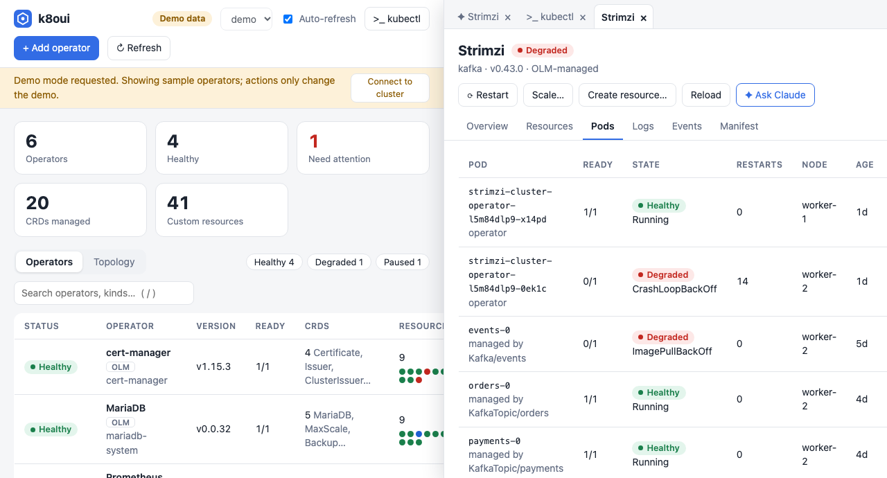

# k8oui

A small web UI to visualise and manage Kubernetes Operators. No dependencies beyond Node ≥ 18 and `kubectl`.

```bash
node server.js            # uses your current kubectl context; falls back to demo data if unreachable
node server.js --demo     # sample data, no cluster needed
node server.js --context kind-foo --port 7788
```
Then open http://127.0.0.1:7788.



## What it does
- **Operators list**: health, version, replicas, CRDs, custom-resource counts, restarts.
- **Topology**: operator → CRD → resource (one coloured dot per instance).
- **Detail drawer**: overview/conditions, resources per CRD, pods, logs, events, deployment manifest.
- **Actions**: restart, scale (0 = pause), view/edit/validate (server dry run)/apply a custom resource, delete a custom resource, or create a new one from a generated template (**+ New** on each CRD). Context switcher in the header.
- **Add operator**: enter a GitHub URL (`https://github.com/owner/repo[/tree/branch/path]`) or a local folder. k8oui clones (shallow) or reads it, detects install methods (Helm chart, `install.yaml`, kustomize, manifest dir), shows the exact command, and offers a dry run before installing. Needs `git` for GitHub sources and `helm` for charts.

## How operators are found
1. OLM `ClusterServiceVersion`s (if OLM is installed): owned CRDs and deployments come from the CSV.
2. Otherwise Deployments that look like operators (`control-plane=controller-manager`, `*operator*`, `*controller-manager*`, …), with CRDs attributed by Helm release annotation, then by matching the CRD API group to the operator name. These are tagged **detected**, since attribution is a heuristic.

## Security model
Runs `kubectl` with your credentials, so treat it like your terminal. It binds to 127.0.0.1, rejects foreign `Host` headers (DNS rebinding), requires an `X-Requested-With` header on every API call (CSRF), passes arguments to kubectl as arrays (no shell), validates names, and only accepts manifests whose `kind`s belong to the selected operator's CRDs. Installing runs Helm/kubectl against code from the source you enter, so only add operators you trust; plans expire after 30 minutes and temp clones are deleted. Don't expose it with `--host 0.0.0.0` without an authenticating proxy.
